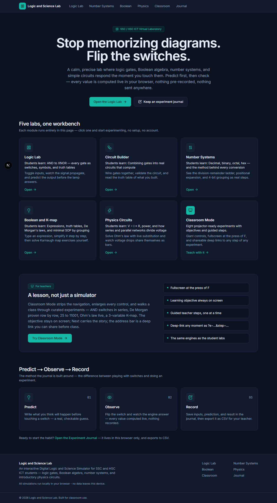
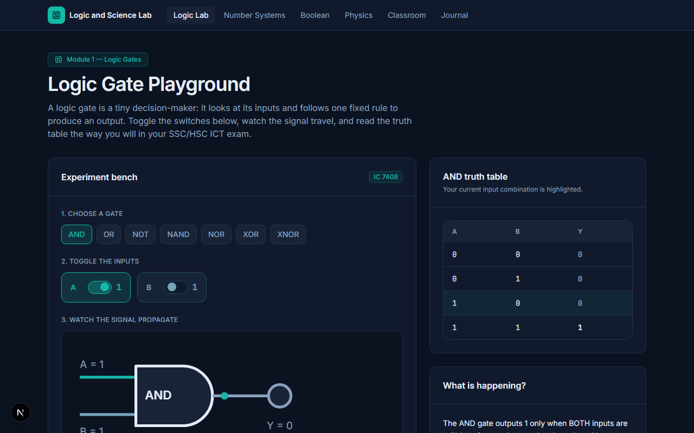
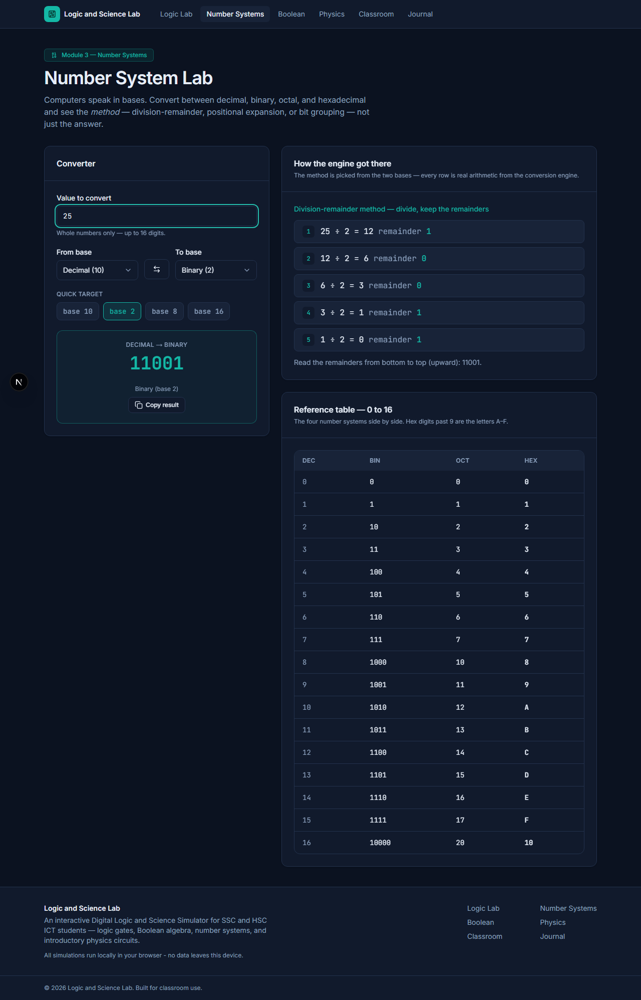
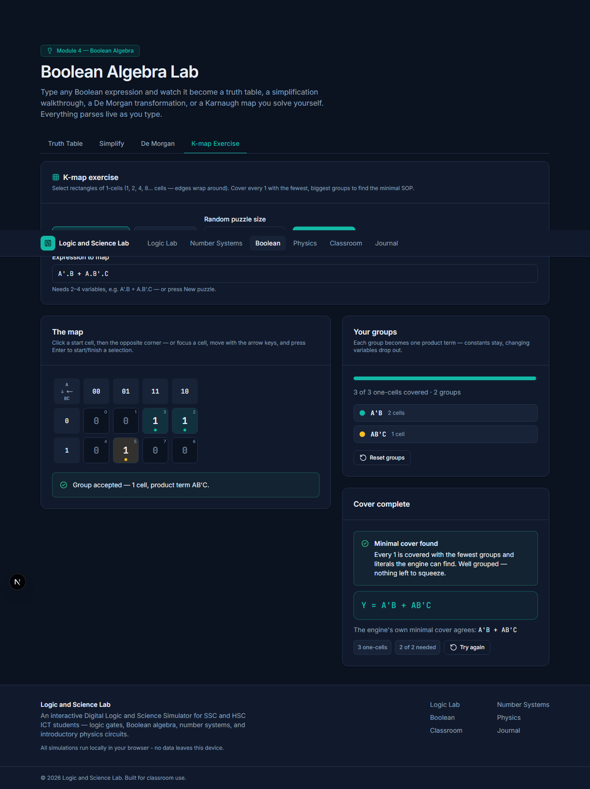
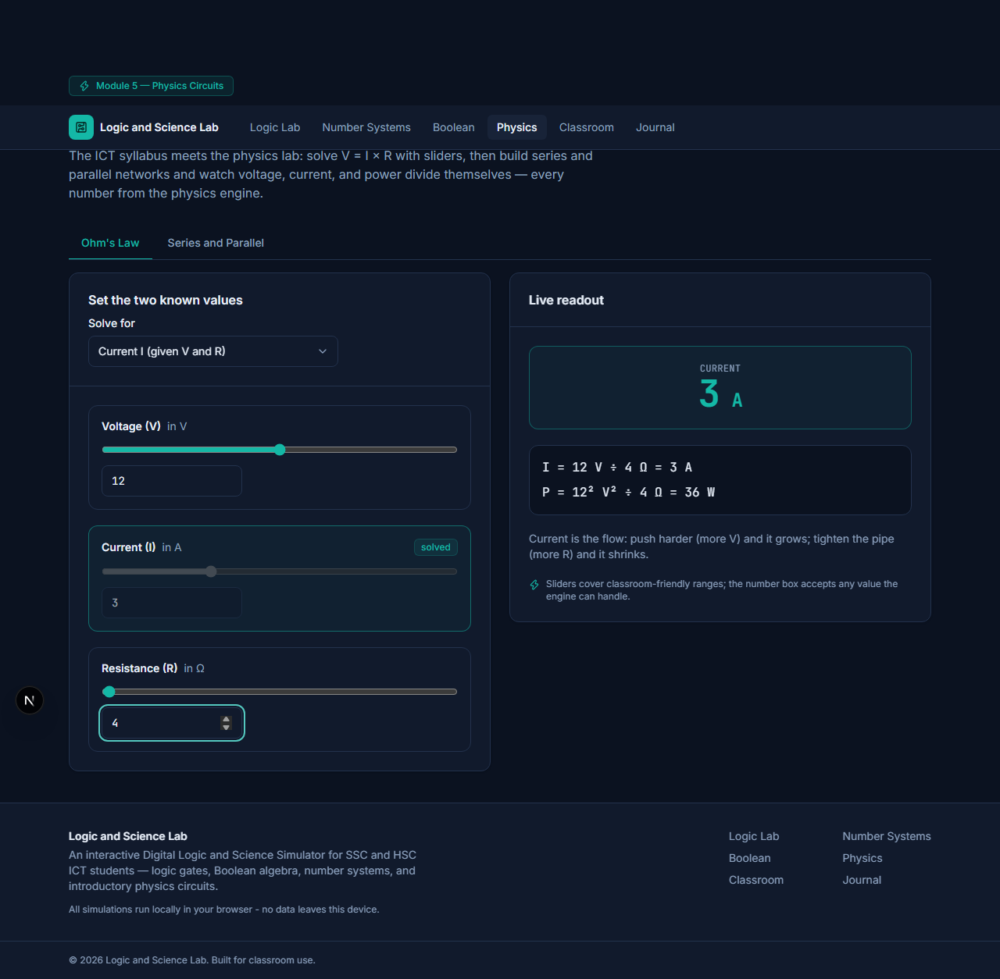
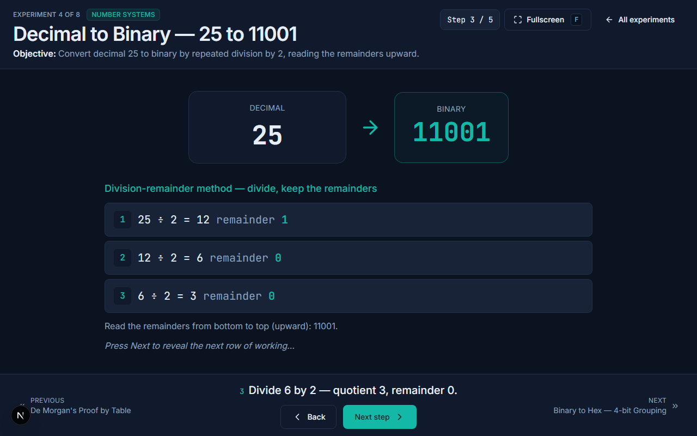

# Digital Logic and Science Simulator

A classroom-friendly interactive simulation suite for digital logic, Boolean
algebra, number systems, and introductory physics circuits — built for
Bangladesh SSC/HSC ICT students and introductory CSE courses, and fully
client-side (no auth, no database, no server state).

## Live Demo

<!-- Replace with the deployed URL after the first Vercel import. -->

**TODO: add deployed URL** (see [Deployment](#deployment) — the Vercel
import needs zero configuration and zero environment variables).

## Screenshots

| | |
| --- | --- |
|  |  |
|  |  |
|  |  |

> Captured from the dev server with `node scripts/screenshots.mjs` (see
> [Deployment](#deployment) for the exact moments each shot freezes).

## Problem

SSC and HSC ICT students meet logic gates, truth tables, Karnaugh maps,
number system conversion, and Ohm's law as **static diagrams to memorize**.
A printed truth table cannot answer "what if I flip B?", a textbook
conversion cannot show its own working step by step, and a school physics
lab rarely has enough kits for every bench. Teachers have no projector-ready
way to run these experiments live in front of a class, and students have no
safe place to make wrong predictions and check them.

## Educational Objective

Turn each syllabus topic into a **predict → observe → record** experiment:

- the student predicts an outcome *before* touching a control,
- the simulator computes what actually happens (live, from real engines),
- the difference between prediction and result is where learning happens,
- the experiment journal turns that habit into evidence a teacher can grade.

## Features

| Route | Module | What it does |
| --- | --- | --- |
| `/` | Landing | Hero, module cards, pedagogy strip |
| `/logic` | Logic Gate Playground | All 7 syllabus gates (AND, OR, NOT, NAND, NOR, XOR, XNOR): input toggles, live SVG symbol, Boolean equation, propagation animation, highlighted truth-table row, teacher-voice explanation, IC numbers |
| `/logic/builder` | Circuit Builder | Gate graph editor: add/remove gates and inputs, wire outputs to inputs, cycle detection, validation, whole-circuit truth table, 4 spec presets |
| `/number-system` | Number System Lab | Decimal/binary/octal/hex conversion with full step-by-step working (division-remainder, positional expansion, 3/4-bit grouping), validation, 0–16 reference table |
| `/boolean` | Boolean Algebra Lab | Expression → truth table + canonical SOP, step-by-step simplification demo (documented identity subset), De Morgan's law walkthrough, interactive Karnaugh map exercise with group validation and minimal-cover checking |
| `/physics` | Physics Circuits Lab | Ohm's law solver (sliders + live substitution + power + extreme-value warnings), series/parallel bench (equivalent resistance, total current, per-resistor voltage/power, drop bars) |
| `/classroom` | Classroom Mode | 8 curated projector experiments, fullscreen (F key), giant controls, learning objective on screen, guided teacher steps, deep-linkable `?e=<id>&step=N` |
| `/journal` | Experiment Journal | Predict/observe/record entries in `localStorage`, module filter, CSV export (RFC 4180 + BOM), two-tab sync via `useSyncExternalStore` |

Formula reference, step formats, and the Boolean expression operator table
live in [`docs/engine-reference.md`](docs/engine-reference.md).

## Technology Stack

- **Next.js 16.3.6** (App Router, static-friendly — all pages are client-side interactive)
- **React 19.3.0** + **React DOM 19.3.0**
- **TypeScript 5.9.3** (strict)
- **Tailwind CSS 4.3.3** (v4, `@theme` tokens in `src/app/globals.css` — no config JS)
- **zod 4.6.5** (journal entry + form validation)
- **lucide-react 1.48.0** (icons)
- Testing: **Vitest 5.0.2** (unit, happy-dom), **Testing Library**,
  **Playwright 1.63.0** (e2e), **ESLint 9.39.0** (eslint-config-next)

## Architecture

**All computation is local, pure TypeScript.** Every number, table, and
simplification step the UI shows is computed live in the browser by engines
in `src/engines/` — plain modules with no React and no I/O. Nothing is
faked, hardcoded, or pre-recorded (spec §36 honesty rule), and nothing is
sent anywhere.

```text
Browser (the whole app)
├── src/app/                 Next.js App Router pages (thin "use client" views)
│   └── /logic /logic/builder /number-system /boolean /physics /classroom /journal
├── src/components/          Views over engine output (ui/, logic/, numbers/,
│   boolean/, physics/, classroom/, journal/, layout/)
├── src/engines/             PURE TypeScript computation — no React
│   ├── logic.ts             7 gates: definitions, truth tables, expressions, IC numbers
│   ├── circuit.ts           combinational graph: wiring, cycles, evaluation, presets
│   ├── numbers.ts           base conversion with positional/division/grouping steps
│   ├── boolean.ts           tokenizer → parser → evaluator → truth tables
│   ├── boolean-simplify.ts  identity-rule simplification DEMO (documented subset)
│   ├── kmap.ts              Gray-coded K-maps, group validation, minimal cover
│   └── physics.ts           Ohm's law, power, series/parallel networks
└── src/lib/                 journal (schema + CSV + storage), journal store
                             (useSyncExternalStore), K-map puzzles, classroom
                             experiment registry, K-map selection rules
```

Pages render **only engine output** — e.g. the physics bench and the K-map
grid are the same components in the student labs and in classroom mode, just
scaled with a `size` prop.

## Database Model

**None — fully client-side.** The experiment journal persists in the
browser's `localStorage` (key `logic-science-journal-v1`, zod-validated on
read; corrupt rows are dropped, never crash). Data never leaves the device.

## Authentication & Authorization

**Not applicable — public classroom tool.** There are no accounts, roles,
or gated features; any student can open the deployed URL and use every
module.

## Testing

- **Unit (Vitest, 13 suites / 279 tests):** every engine has a direct suite —
  gates, truth tables, parsing, simplification rules, K-map grouping and
  validation, circuit graph operations, conversions, physics guard rails,
  journal schema/CSV escaping (RFC 4180 round-trip), classroom registry
  self-check, and the K-map selection rules extracted as pure functions.
- **End-to-end (Playwright, `tests/e2e/smoke.spec.ts`):** one flow per
  module — home cards, gate toggle → equation + highlighted row, 25 →
  11001 with steps, `A AND NOT A` → truth table + simplification to 0,
  V=12/R=4 → 3 A, journal add → list. Every test fails on any browser
  console error.

```bash
npm run test:run    # vitest unit suites
npm run test:e2e    # playwright (needs: npx playwright install)
```

## Local Development

```bash
npm install         # Node 22+ (package.json engines)
npm run dev         # dev server on http://localhost:3001 (turbopack)
```

| Script | What it does |
| --- | --- |
| `npm run dev` | Next dev server (turbopack) on **port 3001** |
| `npm run lint` | ESLint (pinned ^9.39.0 — do not upgrade to 10) |
| `npm run typecheck` | `tsc --noEmit` (strict) |
| `npm run test:run` | Vitest unit tests |
| `npm run test:e2e` | Playwright e2e (expects the dev server per playwright.config.ts) |
| `npm run build` | Production build |

Note: the Next dev server auto-generates `AGENTS.md` and `CLAUDE.md` at the
project root. Both are git-ignored and must never be committed.

## Environment Variables

**None required.** There is no `.env` — the app is fully client-side and
works offline after first load. (`.env.example` exists only to reserve
`MONGODB_URI` for a possible future optional feature; it is commented out
and unused.)

## Deployment

Deploy on Vercel: **import the repo, accept the defaults, deploy.**

1. Push the repo to GitHub.
2. In Vercel: *Add New → Project → import the repository*.
3. Vercel auto-detects Next.js — no build overrides, no environment
   variables, no database to provision.
4. Open the produced URL (and paste it into the Live Demo section above).

See `docs/deployment.md` for the walkthrough with screenshots-to-capture.

## Demo Accounts

**Not applicable** — no authentication exists. Every visitor has full
access to every module.

## Known Limitations

- **Journal is per-browser.** Entries live in one browser's `localStorage`
  on one device; clearing browser data deletes them (export CSV first).
  There is no sync between students or devices.
- **Boolean simplifier is a documented subset, not a prover.** It
  demonstrates double negation, identity, domination, idempotent,
  complement, and De Morgan's laws until a fixpoint. Absorption
  (`X + X.Y`), consensus, factoring, and XOR identities are out of scope —
  expressions outside the subset are returned unchanged once no documented
  rule applies. The UI verifies each result's truth table against the
  original, live. (The K-map tab does find the true minimal SOP for 2–4
  variables.)
- **Circuit Builder is combinational-only.** No flip-flops, latches, clocks,
  or feedback (cycles are detected and rejected by design); at most 3 input
  variables get a full circuit truth table.
- **Physics is DC resistor networks only** (Ohm's law, power, series and
  parallel resistors) — no AC, capacitors, or transients.
- **Number systems are unsigned whole numbers** up to 16 digits / 2^53 − 1;
  no fractions or negative values.

## Future Enhancements

- More guided experiments in classroom mode (half/full adder, BCD, more
  K-map drills) with per-step teacher notes.
- Teacher-authored lesson storage (saved classroom sequences and preset
  circuits) behind an **optional MongoDB** connection — the env names are
  reserved (e.g. `MONGODB_URI`) so the default deployment stays zero-config
  and fully client-side.
- Journal export/import as a file so students can move entries between
  devices without a server.
- Sequential circuit support (latches/flip-flops) in the Circuit Builder.

## Teaching Use Cases

- **Classroom demonstration (projector):** open `/classroom`, press F, and
  walk the 8 curated experiments — each has a learning objective and guided
  steps; `?e=<id>&step=N` deep-links the exact moment you want to start.
- **Predict-before-you-show:** cover the Y column, ask the class to predict,
  then toggle the switch (the Logic Lab's built-in teacher tip).
- **Homework evidence:** students record prediction vs. actual result per
  experiment in `/journal` and submit the exported CSV.
- **Self-study:** the step-by-step working (conversion ladders, substitution
  lines, one-rule-per-step simplification) lets students re-derive every
  answer they will reproduce in the exam.
- **Lab replacement/supplement:** when bench kits are scarce, the physics
  bench gives every student a live series/parallel circuit with warnings
  for extreme values.

See `docs/modules-guide.md` for per-module objectives, a 40-minute
experiment script, and common misconceptions each module addresses, and
`docs/classroom-mode.md` for the teacher walkthrough.

## Interview Talking Points

- **Pure-engine architecture:** all computation in React-free TypeScript
  modules, so every rule is unit-testable and the UI is a thin view —
  "would this logic survive a framework swap?" is answered yes.
- **Honest AI/spec rule:** spec §36 forbids faking results; the Boolean
  simplifier is explicitly labeled a documented-subset demo, and the UI
  verifies equivalence row by row rather than trusting the engine.
- **Exact algorithms:** minimal K-map cover via branch-and-bound over
  Gray-coded rectangles (wraparound included), recursive-descent Boolean
  parser with teaching-quality errors, cycle detection in the circuit
  graph.
- **Accessibility as a feature:** ARIA tabs/switches/roles throughout,
  keyboard-operable K-map (arrow keys + Enter), visible focus states,
  reduced-motion support, WCAG AA on a dark theme.
- **State without a server:** `useSyncExternalStore` over `localStorage`
  keeps two tabs consistent; corrupt stored data is zod-validated and
  dropped, never crashed on.
- **Testing culture:** engine-level unit tests for every rule, plus e2e
  flows that assert computed values (25 → 11001, 12 V ÷ 4 Ω = 3 A) — not
  just "page renders".

## License

[MIT](LICENSE) — see `LICENSE` for the full text.
